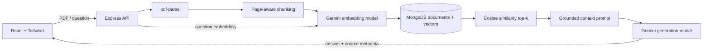

# DocuMind

DocuMind is a small, portfolio-ready Retrieval-Augmented Generation (RAG) application. Upload text-based PDFs, ask questions about them, and receive a Gemini answer grounded in retrieved document chunks with page-aware source citations.

## Features

- PDF upload with MIME type and size validation
- Text extraction with page metadata (OCR is intentionally not included)
- Slightly overlapping document chunks
- Gemini embeddings for both chunks and questions
- Local cosine-similarity vector search backed by MongoDB
- Grounded Gemini answers with explicit source labels
- Document listing and deletion, including vector cleanup
- Responsive React + Tailwind UI
- Focused tests for chunking, retrieval math, and RAG context construction

## Architecture



## Tech stack

- Frontend: React, Vite, JavaScript, Tailwind CSS, Axios
- Backend: Node.js, Express, JavaScript
- Database: MongoDB with Mongoose
- AI: Gemini REST API (`gemini-embedding-001` and `gemini-2.5-flash` by default)
- Vector search: simple cosine similarity in Node over MongoDB-stored embeddings

## Run locally

Requirements: Node.js 20+, MongoDB (or Docker Desktop), and a Gemini API key.

1. Install dependencies:

   ```bash
   npm install
   ```

2. Start MongoDB:

   ```bash
   docker compose up -d mongodb
   ```

3. Copy `.env.example` to `.env` and set `GEMINI_API_KEY`.

4. Start the frontend and backend:

   ```bash
   npm run dev
   ```

   Open <http://localhost:5173>. The API runs at <http://localhost:4000>.

## Environment variables

| Variable | Purpose | Default |
| --- | --- | --- |
| `MONGODB_URI` | MongoDB connection string | `mongodb://localhost:27017/documind` |
| `GEMINI_API_KEY` | Server-only Gemini key | required for upload/query |
| `GEMINI_EMBEDDING_MODEL` | Shared embedding model | `gemini-embedding-001` |
| `GEMINI_GENERATION_MODEL` | Answer model | `gemini-2.0-flash` |
| `MAX_UPLOAD_BYTES` | Maximum PDF size | `10485760` |
| `TOP_K` | Number of retrieved chunks | `5` |
| `FRONTEND_ORIGIN` | CORS origin | `http://localhost:5173` |

## Testing and build

```bash
npm test
npm run build
```

The unit tests do not call MongoDB or Gemini. External APIs should be exercised manually with a configured key.

## Limitations

- No authentication: this demo is intended for local or trusted environments.
- Uploaded files are processed in memory and are not retained after embedding.
- Cosine search scans all chunks, which is suitable for a portfolio-scale demo but not a large corpus.
- Scanned/image-only PDFs need OCR and are rejected with a clear message.
- Page boundaries depend on the PDF text layer; unusual PDFs may not expose exact page breaks.
- Gemini availability, model names, quotas, and API behavior can change; models are configurable through environment variables.
